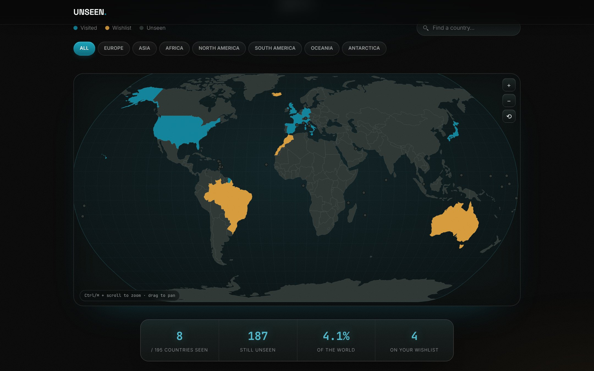
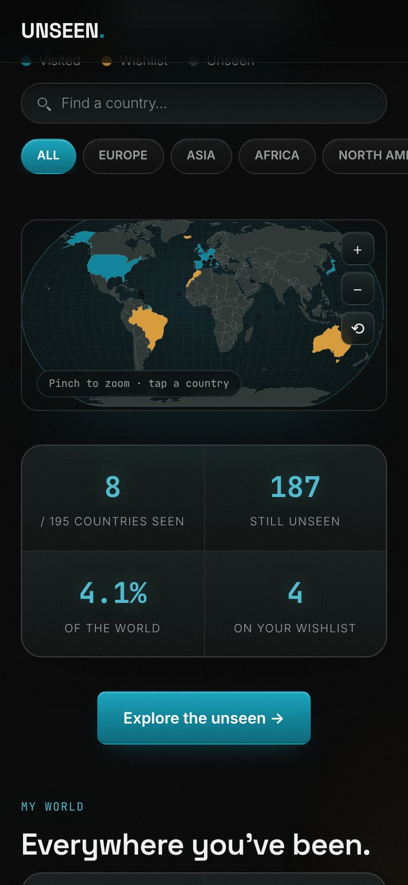

# UNSEEN.

**How much of the world is still waiting for you?**

[](https://github.com/abejit-singh/unseen/actions/workflows/ci.yml)

**Live:** [abejit-singh.github.io/unseen](https://abejit-singh.github.io/unseen/)

UNSEEN is an interactive world map for tracking where you've been. It is not a checklist: the map fills in as you mark countries visited, and every place keeps its own record of dates, cities, a rating, a memory and a photo.

No backend, no framework, no build step. Everything runs in the browser and is saved in its `localStorage`.

<p>
  
  
</p>

## Features

- **A real geographic map.** Actual country borders (Natural Earth data via D3 and topojson), not a static image. Every country can be clicked, hovered, zoomed and panned.
- **All 195 countries.** The 193 UN members plus the two observer states. The 29 countries too small to have a shape at this scale (Malta, Singapore, San Marino, Vatican City and others) are drawn as dots at their real location. Dots that sit inside another country become clickable once you zoom in, so they never steal a tap meant for Italy or France.
- **Territories, handled honestly.** Greenland, Puerto Rico, Antarctica and a few other areas appear on the map and can be marked, but they don't count toward the 195. The headline number means what it says.
- **Three states per place.** Unseen, visited or wishlist. Each change spreads its new colour outward from the country's centre.
- **Country details.** First visited date, cities, a 1–10 rating, a short memory, number of trips and an optional photo, all editable from a side panel (a bottom sheet on phones).
- **Find a country.** A search field that also gives keyboard and screen-reader users a way to reach any country.
- **Continent filters.** Dim and zoom the map to one continent, with live stats for how much of it you've explored.
- **My World.** Totals for countries, continents and cities visited, your best-rated place, and a progress bar per continent.
- **Your Memories.** The notes, ratings and photos you've attached to visited places.
- **Travel Timeline.** Generated automatically from the dates you enter.
- **What's Next.** Suggestions based on real distances from the map data:
  - the closest unseen countries to anywhere you've been;
  - the most distant ones on continents you haven't visited yet;
  - your wishlist;
  - a random pick.
- **World Score.** An internal index of your progress, clearly labelled as such.

All numbers are computed live from what you enter. Nothing is hardcoded or simulated.

## Using the map

- **Desktop:** drag to pan. Zoom with Ctrl/⌘ + scroll, a trackpad pinch, or the + / − buttons. Plain scrolling keeps scrolling the page.
- **Phone or tablet:** pinch to zoom, tap a country. At full view, one finger scrolls the page; once you've zoomed in, it pans the map.

## Running it locally

You need [Node.js](https://nodejs.org) 22 or later.

```sh
npm install
npm start
```

Then open <http://127.0.0.1:5173>.

The page is made of ES modules, which browsers only load from a server: opening `index.html` with a double-click shows an empty page. `npm start` runs a small static server; any other one works too.

## Scripts

| Command             | What it does                                              |
| ------------------- | --------------------------------------------------------- |
| `npm start`         | Serves the site at `http://127.0.0.1:5173`                |
| `npm run lint`      | ESLint, Stylelint and a Prettier formatting check         |
| `npm run format`    | Formats every file with Prettier                          |
| `npm run test:unit` | Unit tests of the calculations and the saved data         |
| `npm run test:e2e`  | The page in a real browser, at a desktop and a phone size |
| `npm test`          | Both kinds of test                                        |

The browser tests use [Playwright](https://playwright.dev), which needs its browser once: `npx playwright install chromium`.

The same checks run on GitHub Actions at every push (`.github/workflows/ci.yml`).

## Project structure

```
index.html            the page: the markup of every section
css/
  fonts.css           the typefaces the site serves itself
  style.css           every style, by section, with a contents list at the top
js/
  main.js             entry point: starts the app
  config.js           data tables: continents, countries, territories, small states
  utils.js            small helpers: text, dates, flags, distances
  places.js           one list of everything that can be marked
  state.js            the saved data: loading, checking, saving
  effects.js          motion: counting numbers, the toast, pointer effects
  sections.js         figures, My World, memories, timeline and score
  map.js              the map: drawing, zoom and pan, continent filters
  panel.js            a country's panel: visit, cities, rating, memory, photo
  explore.js          search, filters, the surprise card and What's Next
  vendor/             D3 and topojson-client, unmodified
data/                 the shapes of the countries (world-atlas, 110m)
fonts/                the typefaces (woff2) and their licences
icons/                the app icons
images/               the preview shown when the link is shared
docs/                 the screenshots on this page
tests/
  unit/               the calculations and the saved data, run in Node
  e2e/                the page in a real browser (Playwright)
manifest.json         app name, colours and icons for installation
service-worker.js     offline support
```

## How it is built

- **No framework and no build step.** Plain HTML, CSS and JavaScript. The files in this repository are the files the browser runs, and GitHub Pages serves the `main` branch as it is.
- **ES modules.** One module for each part of the page, loaded by the browser from `js/main.js`. The foundation (`config.js` → `utils.js` → `places.js` → `state.js`) imports nothing from the modules built on top of it.
- **One state object.** Everything the user enters lives in one object, saved to `localStorage` after every change. When it is read back every field is checked, so damaged or hand-edited data cannot break the page.
- **Rendering.** Each section has a function that rebuilds its markup from the state. Text typed by the user is escaped before it is inserted.
- **The map.** Drawn with [D3](https://d3js.org) in the Natural Earth projection, from the 110m shapes of [world-atlas](https://github.com/topojson/world-atlas). The 29 countries too small to have a shape at that scale are drawn as dots at their real coordinates; the ones inside a bigger country (San Marino, Monaco…) only become clickable after zooming in, so they don't steal taps meant for Italy or France.
- **The rest of the page doesn't wait for the map.** Figures, memories, timeline and score need no geography, so they are rendered before the world shapes have loaded.
- **Photos stay small.** A photo is resized on the device to a small JPEG before it is saved, so it fits in `localStorage`.
- **Nothing comes from another site.** The typefaces (Inter, Space Grotesk and JetBrains Mono), the map libraries and the world shapes are served from this repository, and a Content Security Policy (`default-src 'self'`) makes the browser refuse anything else.
- **Offline.** A service worker keeps a copy of the app. Online, the page is always fetched fresh, so an update shows immediately; the copy is only used when there is no connection.
- **Motion is optional.** Animations are switched off for people who ask their system for reduced motion.

## Quality

- **Tests.** Unit tests for the calculations and for the data read back from storage; browser tests that use the page the way a visitor does, including reopening it with no connection and checking that it calls no other site.
- **Accessibility.** Labelled controls, keyboard access and text contrast that meets WCAG AA, checked with axe on the empty page and with data. The map is a picture to a screen reader: the search field does everything a click on the map does.
- **Lighthouse** (phone profile, on a local copy served the way GitHub Pages serves it, November 2026): Performance about 90 (drawing the world map is the heavy part) · Accessibility 100 · Best Practices 100 · SEO 100.

## Installing as an app (PWA)

UNSEEN is a Progressive Web App: on the live site you can install it like a native app, with its own icon, and it keeps working offline.

- **On mobile:** open the site, then use your browser's "Add to Home Screen" option (Safari: Share → Add to Home Screen; Chrome: menu → Install app).
- **On desktop:** Chrome and Edge show an install icon in the address bar.

## Privacy

UNSEEN collects nothing and sends nothing anywhere. There is no backend at all.

- **What's stored:** the places you mark, your wishlist, and the visit dates, cities, ratings, memories, trip counts and photos you add. It is saved only in your browser's `localStorage`, under the key `unseen_state_v1`. Photos are resized on your device to a small JPEG before being stored.
- **Where it goes:** nowhere. None of your data ever leaves your device. There's no analytics, tracking, cookies or logging of any kind.
- **Outside requests:** none. The page, its fonts, the map libraries and the map data all come from this site, and the Content Security Policy blocks any other connection.
- **Security:** all text you enter is escaped before it is displayed, and saved data is validated every time it is read.
- **Clearing your data:** use the reset button (top-right of the site) at any time.

## Third-party files

Fonts: see [`fonts/README.md`](fonts/README.md) (SIL Open Font License). Map libraries and data: see [`js/vendor/README.md`](js/vendor/README.md) (ISC; Natural Earth data is in the public domain).

## Disclaimer

The World Score and continent statistics are an internal, illustrative index based on the places you've marked, not an official or scientific measure of anything. The country and territory classification follows the 193 UN member states plus the two UN observer states, and implies no position on any disputed status.

## Copyright

© 2026 Abejit. All rights reserved.

This project is shared publicly on GitHub for portfolio purposes. No license is granted to copy, modify, redistribute or reuse this code or design. Please don't recreate this project. If you'd like to use any part of it, get in touch first.
